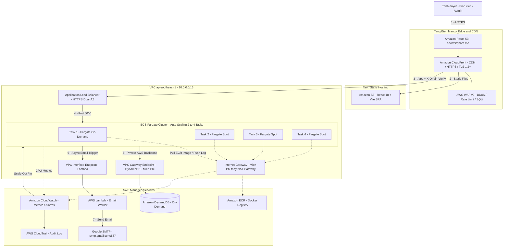

# 🎓 Hệ Thống Đăng Ký Môn Học Trực Tuyến — Cloud-Native on AWS

> **Kiến trúc Serverless & Containerized co giãn tự động, bảo mật nhiều lớp, tối ưu chi phí triệt để ($0 NAT Gateway · $0 SES · $0 Secrets Manager) trên nền tảng Amazon Web Services.**

[](https://www.terraform.io/)
[](https://aws.amazon.com/fargate/)
[](https://aws.amazon.com/dynamodb/)
[](https://aws.amazon.com/lambda/)
[-2088FF?logo=githubactions&logoColor=white)](https://github.com/features/actions)
[](https://fastapi.tiangolo.com/)
[](https://react.dev/)
[](https://enormitpham.me)

---

## 📌 Mục Lục

1. [Lý Do Chọn Đề Tài & Bài Toán Thực Tế](#1-lý-do-chọn-đề-tài--bài-toán-thực-tế)
2. [Sơ Đồ Kiến Trúc](#2-sơ-đồ-kiến-trúc)
3. [Phân Tích Kiến Trúc — 5 Trụ Cột Kỹ Thuật](#3-phân-tích-kiến-trúc--5-trụ-cột-kỹ-thuật)
   - [3.1 Bảo Mật Đa Tầng (Security-in-Depth & Zero-Trust)](#31-bảo-mật-đa-tầng-security-in-depth--zero-trust)
   - [3.2 Tối Ưu Chi Phí ($0 NAT · $0 SES · $0 Secrets Manager)](#32-tối-ưu-chi-phí-0-nat--0-ses--0-secrets-manager)
   - [3.3 Hiệu Năng Cao (High Performance)](#33-hiệu-năng-cao-high-performance)
   - [3.4 Chịu Lỗi & Sẵn Sàng Cao (High Availability Multi-AZ)](#34-chịu-lỗi--sẵn-sàng-cao-high-availability-multi-az)
   - [3.5 Co Giãn Tự Động (Auto Scaling In/Out)](#35-co-giãn-tự-động-auto-scaling-inout)
4. [Phân Tích Ưu & Nhược Điểm](#4-phân-tích-ưu--nhược-điểm)
5. [Hướng Dẫn Cài Đặt & Cấu Hình](#5-hướng-dẫn-cài-đặt--cấu-hình)
   - [5.1 Yêu Cầu Tiên Quyết](#51-yêu-cầu-tiên-quyết)
   - [5.2 Cấu Hình Git & Biến Môi Trường](#52-cấu-hình-git--biến-môi-trường)
   - [5.3 Triển Khai Hạ Tầng bằng Terraform](#53-triển-khai-hạ-tầng-bằng-terraform)
   - [5.4 Cấu Hình CI/CD — GitHub Actions OIDC](#54-cấu-hình-cicd--github-actions-oidc)
   - [5.5 Nạp Dữ Liệu Mẫu & Tài Khoản Demo](#55-nạp-dữ-liệu-mẫu--tài-khoản-demo)
   - [5.6 Chạy Local (Docker Compose)](#56-chạy-local-docker-compose)
   - [5.7 Stress Test với k6](#57-stress-test-với-k6)
6. [Các Test Case Đã Kiểm Thử Thực Tế](#6-các-test-case-đã-kiểm-thử-thực-tế)
7. [Cấu Trúc Thư Mục Dự Án](#7-cấu-trúc-thư-mục-dự-án)

---

## 1. Lý Do Chọn Đề Tài & Bài Toán Thực Tế

### 1.1 Bài Toán: Flash Crowd trong Đăng Ký Môn Học

Hệ thống đăng ký môn học trực tuyến của trường đại học là một bài toán kỹ thuật kinh điển mang tên **Flash Crowd — Tải tăng đột biến cục bộ**:

| Vấn đề | Mô tả chi tiết |
|:---|:---|
| **Tải không đồng đều** | 95% thời gian hệ thống ở trạng thái idle. Nhưng chính xác vào giờ mở cổng đăng ký (8:00 sáng), hàng nghìn sinh viên đồng loạt gửi request trong vòng vài phút. |
| **Rủi ro sập hệ thống** | Máy chủ cố định (EC2 đơn lẻ, On-Premise) sẽ nghẽn cổ chai, trả về lỗi `504 Gateway Timeout` đúng thời điểm quan trọng nhất. |
| **Race Condition** | Sĩ số mỗi lớp có hạn (ví dụ: 40 sinh viên). Xử lý đồng thời kém sẽ dẫn đến "over-booking" — đăng ký vượt quá sức chứa. |
| **Nghịch lý chi phí** | Thuê máy chủ lớn quanh năm = lãng phí hàng nghìn USD. Thuê nhỏ = sập web đúng lúc cần nhất. |

### 1.2 Tại Sao Chọn Kiến Trúc Cloud-Native Serverless Container?

Đây là lựa chọn **tối ưu duy nhất** giải quyết đồng thời cả 4 vấn đề trên:

- ✅ **ECS Fargate**: Không cần quản lý máy chủ, tự động co giãn từ 2 lên 4 task trong vài phút — ứng phó chính xác với Flash Crowd.
- ✅ **DynamoDB Conditional Write**: Giải quyết Race Condition hoàn toàn bằng `ConditionExpression` ở cấp database — không cần lock ứng dụng.
- ✅ **Pay-per-use**: DynamoDB On-Demand + Fargate Spot = chi phí bằng $0 khi idle, chỉ phát sinh khi có lưu lượng thực.
- ✅ **Infrastructure as Code (Terraform)**: Toàn bộ hạ tầng được định nghĩa dưới dạng code — dựng lại từ đầu trong 5 phút, không có "snowflake server".

---

## 2. Sơ Đồ Kiến Trúc

> [!NOTE]
> Hệ thống **không dùng AWS SES** và **không dùng AWS Secrets Manager**. Email thông báo được gửi bất đồng bộ qua **Lambda Worker + Google SMTP**; JWT Secret được sinh ngẫu nhiên 64 ký tự bằng Terraform `random_password`.



### Luồng Request End-to-End

| Bước | Thành phần | Vai trò |
|:---:|:---|:---|
| ① | Route 53 | DNS phân giải `enormitpham.me` → CloudFront |
| ② | CloudFront + WAF | Lọc DDoS/SQLi/XSS; phục vụ static file từ S3 (cache PoP toàn cầu) |
| ③ | CloudFront → ALB | Forward `/api/*` kèm header bí mật `X-Origin-Verify` |
| ④ | ALB → ECS | Chỉ nhận traffic từ CloudFront IP ranges; reverse proxy port 8000 |
| ⑤ | ECS → DynamoDB | Qua VPC Gateway Endpoint (đường nội bộ AWS, không qua Internet) |
| ⑥⑦ | ECS → Lambda → Gmail | Gửi email xác nhận bất đồng bộ, không block API response |

---

## 3. Phân Tích Kiến Trúc — 5 Trụ Cột Kỹ Thuật

### 3.1 Bảo Mật Đa Tầng (Security-in-Depth & Zero-Trust)

Kiến trúc bảo mật được thiết kế theo mô hình **Defense-in-Depth**: kẻ tấn công phải phá vỡ đồng thời nhiều lớp độc lập nhau.

```
Internet ──► WAF v2 ──► CloudFront ──► ALB (Custom Header) ──► ECS SG ──► DynamoDB VPCE
               ↑              ↑               ↑                    ↑             ↑
           Lớp 1: DDoS    Lớp 2: TLS    Lớp 3: Bypass      Lớp 4: SG     Lớp 5: Private
           Rate Limit      HTTPS 1.2+    Protection        Source-only    Network Path
```

**Chi tiết từng lớp bảo mật:**

**Lớp 1 — AWS WAF v2 (DDoS & OWASP Top 10):**
- Rate Limiting: Tự động block IP gửi quá ngưỡng request/phút.
- Managed Rule Groups: Tự động lọc SQL Injection, Cross-Site Scripting (XSS), và các lỗ hổng OWASP Top 10.
- WAF gắn trực tiếp vào CloudFront Distribution — lọc tại tầng biên toàn cầu, không đến được backend.

**Lớp 2 — CloudFront TLS & ALB Security Group (ALB-Only Ingress):**
- ALB Security Group chỉ cho phép traffic từ **CloudFront Managed Prefix List** (`com.amazonaws.global.cloudfront.origin-facing`) trên port 80.
- Mọi request trực tiếp đến IP/DNS của ALB (bỏ qua CloudFront) đều bị **block hoàn toàn** ở cấp Network.

**Lớp 3 — Custom Header `X-Origin-Verify` (Bypass Protection):**
- CloudFront nhúng một secret ngẫu nhiên 32 ký tự vào header `X-Origin-Verify` với mọi request tới ALB.
- ALB Listener Rule kiểm tra header: nếu thiếu hoặc sai → trả về `403 Forbidden` ngay lập tức, không chuyển đến ECS.
- Secret được sinh bởi Terraform `random_password` — không bao giờ được hardcode.

**Lớp 4 — ECS Security Group (Port-Level Isolation):**
- ECS container **chặn 100% Inbound từ `0.0.0.0/0`**.
- Ingress duy nhất được phép: port 8000, nguồn = **ALB Security Group ID** (không phải CIDR).
- Kể cả admin không thể SSH hay telnet vào container.

**Lớp 5 — DynamoDB VPC Gateway Endpoint (Private Network Path):**
- Toàn bộ traffic ECS ↔ DynamoDB đi qua đường nội bộ của AWS backbone — không bao giờ đi ra Internet công cộng.
- Loại bỏ nguy cơ Man-in-the-Middle khi truy cập database.

**Lớp 6 — CI/CD OIDC Keyless (Zero Long-lived Credentials):**
- **Không lưu** `AWS_ACCESS_KEY_ID` hay `AWS_SECRET_ACCESS_KEY` dài hạn ở GitHub Secrets.
- GitHub Actions trao đổi **OIDC JWT Token** với AWS STS để nhận quyền tạm thời (TTL 1 giờ).
- IAM Role Trust Policy kiểm soát chặt: chỉ cho phép `repo:Enormit*/Cloud*:ref:refs/heads/main`.

---

### 3.2 Tối Ưu Chi Phí ($0 NAT · $0 SES · $0 Secrets Manager)

> [!TIP]
> **Tiết kiệm >85% chi phí hạ tầng** so với kiến trúc chuẩn sách giáo khoa bằng 5 quyết định thiết kế táo bạo.

**Quyết định 1 — $0 NAT Gateway (Tiết kiệm ~$65/tháng):**

Kiến trúc thông thường: ECS trong Private Subnet → buộc phải thuê NAT Gateway để kéo Docker image và gửi log.
```
Private Subnet ECS → NAT Gateway ($32.40/AZ × 2 AZs = $64.80/tháng) → Internet
```

Kiến trúc này: ECS trong **Public Subnet** + `assign_public_ip = true` → dùng Internet Gateway (miễn phí):
```
Public Subnet ECS (có Public IP) → Internet Gateway ($0) → Internet
```
> Bảo mật vẫn đảm bảo: Security Group chặn 100% Inbound từ `0.0.0.0/0`. Public IP chỉ cho phép ECS **đi ra** (outbound) để kéo image, ghi log — không ai vào được.

**Quyết định 2 — $0 AWS SES (Dùng Lambda + Gmail SMTP):**

AWS SES Sandbox Mode yêu cầu xác minh từng email người nhận — không thực tế cho demo. Thay vào đó:
- **Lambda Email Worker** chạy Serverless **ngoài VPC** → có Internet access sẵn miễn phí.
- Gửi mail qua `smtp.gmail.com:587` với Gmail App Password.
- Backend gọi Lambda qua VPC Interface Endpoint bất đồng bộ → API response không bị chậm.

**Quyết định 3 — $0 Secrets Manager (Dùng Terraform `random_password`):**

AWS Secrets Manager: $0.40/secret/tháng + thêm phức tạp IAM. Thay vào đó:
```hcl
resource "random_password" "jwt_secret" {
  length  = 64
  special = true
}
# Inject thẳng vào environment variable của ECS Task Definition
```
Secret không bao giờ lộ ra ngoài vì nằm trong Terraform State (được mã hóa ở S3).

**Quyết định 4 — Fargate Spot (Giảm 70% chi phí Compute):**
- 2 task cơ sở: **Fargate On-Demand** (đảm bảo availability).
- Khi scale-out lên 4 task: 2 task phụ dùng **Fargate Spot** (rẻ hơn 70%).

**Quyết định 5 — DynamoDB On-Demand:**
- Không trả phí RCU/WCU cố định. Chi phí = $0 khi không có traffic.

#### Bảng So Sánh Chi Phí Hàng Tháng

| Hạng mục | Kiến trúc thông thường | Kiến trúc này | Tiết kiệm |
|:---|:---:|:---:|:---:|
| NAT Gateway (2 AZs) | ~$65.00 | **$0.00** | **100%** |
| ECR VPC Endpoints | ~$15.00 | **$0.00** | **100%** |
| AWS SES | ~$2–5 | **$0.00** | **100%** |
| AWS Secrets Manager | ~$1.60 | **$0.00** | **100%** |
| ECS Fargate Compute | ~$30.00 | **~$10–14** (Spot) | **~65%** |
| DynamoDB | ~$30.00 (Provisioned) | **~$0.50–2** (On-Demand) | **>90%** |
| S3 + CloudFront | ~$5.00 | **~$0.50–1** (Free Tier) | **~80%** |
| **TỔNG** | **~$150–180/tháng** | **~$15–22/tháng** | **>85%** |

---

### 3.3 Hiệu Năng Cao (High Performance)

| Thành phần | Giải pháp | Kết quả thực đo |
|:---|:---|:---|
| **Backend** | FastAPI Async non-blocking (Python ASGI) | Latency trung bình 40–80ms |
| **Database** | DynamoDB Single-Digit Millisecond | Đọc/ghi <10ms |
| **Frontend** | CloudFront CDN Edge Caching toàn cầu | TTFB <30ms |
| **Email** | Lambda Worker bất đồng bộ | API phản hồi <100ms, không chờ SMTP |
| **Đăng ký đồng thời** | DynamoDB `ConditionExpression` Atomic Write | Không over-booking dù 50 VU concurrent |

**Tại sao FastAPI?** FastAPI sử dụng `asyncio` — một coroutine đang chờ I/O (DynamoDB, Lambda) không block thread, cho phép xử lý hàng trăm request đồng thời trên 0.25 vCPU.

**Tại sao DynamoDB?** Latency nhất quán <10ms dù bảng có hàng triệu item, không cần warmup, không có concept "cold query". Hoàn toàn phù hợp với mô hình "query by primary key" của hệ thống đăng ký môn học.

---

### 3.4 Chịu Lỗi & Sẵn Sàng Cao (High Availability Multi-AZ)

**Multi-AZ Deployment:**
```
ALB (ap-southeast-1a) ←────→ ALB (ap-southeast-1b)
       │                              │
  ECS Task 1                     ECS Task 2
  (On-Demand)                    (Fargate Spot)
```
- Hạ tầng phân bổ trên 2 Availability Zones (`ap-southeast-1a` và `ap-southeast-1b`).
- Nếu một AZ ngã, ALB tự động điều hướng 100% traffic sang AZ còn lại — **zero manual intervention**.

**Zero-Downtime Rolling Deployment:**
```
Cấu hình ECS: minimum_healthy_percent = 100 | maximum_percent = 200
```
Quy trình deploy tự động:
1. ECS khởi tạo container **mới** song song với container **cũ**.
2. Container mới phải vượt qua **ALB Health Check** (`/health` endpoint).
3. Chỉ khi container mới `healthy`, ECS mới drain và terminate container cũ.
4. Người dùng **không bao giờ thấy downtime**.

**Deployment Circuit Breaker:**
- Nếu phiên bản mới bị crash loop (không vượt qua health check), ECS tự động **rollback** về bản ổn định trước đó mà không cần can thiệp thủ công.

**DynamoDB Managed HA:**
- AWS quản lý tự động replication đa AZ cho DynamoDB — không cần cấu hình backup thủ công.

---

### 3.5 Co Giãn Tự Động (Auto Scaling In/Out)

Hệ thống dùng **AWS Application Auto Scaling — Target Tracking Policy** với chỉ số CPU:

```
Capacity Range: min = 2 tasks  ←────────────────→  max = 4 tasks
Target Metric: CPU Utilization = 30%
```

**Scale-Out (Mở rộng nhanh khi tải tăng):**

```
CloudWatch AlarmHigh: CPU > 30% trong 3 chu kỳ × 60s = 3 phút liên tiếp
       ↓
Application Auto Scaling: desired = 4 (scale_out_cooldown = 30s)
       ↓
ECS khởi tạo thêm 2 task Fargate Spot trong ~45 giây
       ↓
CPU hạ về ~25% — hệ thống ổn định
```

**Scale-In (Hạ tải an toàn, chống Flapping):**

```
CloudWatch AlarmLow: CPU < 27% trong 15 chu kỳ × 60s = 15 PHÚT liên tiếp
       ↓ (scale_in_cooldown = 180s)
Scale In từng bậc: 4 → 3 → 2 tasks (không drop về minimum ngay lập tức)
```

> [!IMPORTANT]
> **Tại sao cần 15 phút để Scale-In?** — Đây là cơ chế chống **Thrashing/Flapping**: nếu scale-in quá nhanh, ngay khi tắt container thì một đợt tải mới ập đến, lại phải scale-out, lại tốn 45s cold start. Với `AlarmLow` yêu cầu 15 phút ổn định liên tục, hệ thống đảm bảo không có đợt tải muộn nào bị bỏ lỡ.

**Kết quả thực đo (k6 Stress Test — 50 VUs × 5.5 phút):**

| Thời điểm | Sự kiện | Số Tasks |
|:---|:---|:---:|
| t=0 | Bắt đầu test | 2 |
| t=3 phút | CPU đạt 97.86% → AlarmHigh ALARM | 2 |
| t=3.5 phút | Auto Scaling kích hoạt | **4** |
| t=5.5 phút | Dừng test, CPU xuống 5% | 4 |
| t=20 phút | AlarmLow đủ 15 chu kỳ | **3** |
| t=23 phút | Cooldown 180s xong | **2** |

---

## 4. Phân Tích Ưu & Nhược Điểm

| Hạng mục | ✅ Ưu điểm | ⚠️ Nhược điểm & Giới hạn | 🚀 Hướng nâng cấp |
|:---|:---|:---|:---|
| **Hạ tầng (IaC)** | 100% Terraform — dựng lại toàn bộ môi trường <5 phút. Không có snowflake server. | Thay đổi VPC CIDR hay resource gắn liền VPC dễ trigger `destroy + recreate`. | Module hóa sâu hơn; áp dụng Terraform Workspaces cho staging/prod. |
| **Chi phí** | Tiết kiệm >85%. Idle cost ~$15–22/tháng. Không NAT, không SES, không Secrets Manager. | Phụ thuộc vào tính sẵn có của Fargate Spot tại region Singapore (có thể bị thu hồi). | Đã cấu hình `base=2` On-Demand đảm bảo 2 task luôn sống. |
| **Bảo mật** | WAF v2, Custom Header, OIDC Keyless, SG Source-based, DynamoDB VPC Endpoint. Không có long-lived key. | Trust Policy wildcard OIDC cần quản lý chặt. IAM Role quá rộng quyền là attack vector. | Tích hợp AWS GuardDuty, Security Hub; áp dụng IAM Access Analyzer. |
| **Hiệu năng & Scaling** | Scale 2→4 task hoàn hảo. Uptime 99.76% dưới 50 VU concurrent. Latency <100ms. | Fargate **Cold Start** ~45s — không phù hợp nếu cần scale sub-second. Không có cache layer. | Thêm ElastiCache Redis cho hot data; xem xét EKS + Karpenter khi lên hàng triệu user. |
| **Database** | DynamoDB <10ms, fully managed, auto-backup, không quản lý server. Race condition được giải quyết bằng Conditional Write. | Không hỗ trợ JOIN phức tạp như SQL; phải thiết kế bảng theo Access Pattern từ đầu. | AWS Athena + Glue cho reporting/analytics nếu cần thống kê phức tạp. |
| **CI/CD** | OIDC Keyless — không lưu credential. Auto build, test, deploy khi push lên `main`. Rollback tự động. | Pipeline chạy tuần tự — frontend và backend CI song song nhưng deploy là sequential. | Tách backend/frontend deploy thành 2 job song song; thêm canary deployment. |
| **Email** | Lambda Serverless — bất đồng bộ, không block API. $0 với lưu lượng thấp (Free Tier 1M req/tháng). | Gmail App Password là bí mật dài hạn — cần quản lý rotate định kỳ. SLA email phụ thuộc Google. | Migrate sang AWS SES Production (sau khi xác minh domain) hoặc SendGrid để tăng deliverability. |
| **Observability** | CloudWatch Metrics, Alarms, Container Insights Enhanced. CloudTrail audit log toàn diện. | Không có distributed tracing (X-Ray). Log tìm kiếm phức tạp hơn so với ELK/Datadog. | Tích hợp AWS X-Ray để trace request end-to-end; OpenSearch cho log analytics. |

---

## 5. Hướng Dẫn Cài Đặt & Cấu Hình

### 5.1 Yêu Cầu Tiên Quyết

| Công cụ | Phiên bản tối thiểu | Mục đích |
|:---|:---|:---|
| [Terraform](https://developer.hashicorp.com/terraform/downloads) | `>= 1.5.0` | Triển khai hạ tầng AWS |
| [AWS CLI](https://aws.amazon.com/cli/) | `>= 2.x` | Tương tác với AWS từ terminal |
| [Docker](https://www.docker.com/) | `>= 24.x` | Build & chạy container local |
| [Python](https://www.python.org/) | `>= 3.11` | Seed data script, backend local |
| [Node.js](https://nodejs.org/) | `>= 20.x` | Build frontend React/Vite |
| [k6](https://k6.io/) | `>= 0.50` | Stress test |
| Tài khoản AWS | — | Quyền tạo VPC, ECS, DynamoDB, Lambda,... |
| GitHub Account | — | Fork repo, cấu hình Actions Secrets |
| Gmail Account | — | Tạo App Password cho Lambda Email Worker |

---

### 5.2 Cấu Hình Git & Biến Môi Trường

#### Bước 1 — Clone repository

```bash
git clone https://github.com/Enormit/Cloud.git
cd Cloud
```

#### Bước 2 — Cấu hình Git (lần đầu)

```bash
# Thiết lập thông tin cơ bản
git config --global user.name "Your Name"
git config --global user.email "your-email@example.com"

# Kiểm tra remote origin
git remote -v

# (Nếu fork) Đổi remote về repo của bạn
git remote set-url origin https://github.com/<YOUR_USERNAME>/Cloud.git
```

#### Bước 3 — Cấu hình `.env` cho môi trường Local

Sao chép file mẫu và điền thông tin:

```bash
cp .env.example .env
```

Chỉnh sửa `.env`:

```bash
# === XÁC THỰC JWT ===
SECRET_KEY=your-super-secret-key-64-chars-min-change-this
ALGORITHM=HS256
ACCESS_TOKEN_EXPIRE_MINUTES=1440

# === DATABASE ===
# Chạy local với DynamoDB Local (Docker Compose)
USE_LOCAL_DYNAMODB=true
DYNAMODB_ENDPOINT_URL=http://dynamodb-local:8000
DYNAMODB_REGION=ap-southeast-1

# === EMAIL (môi trường local — dùng mock để xem email ngay trên UI) ===
EMAIL_PROVIDER=mock
DEFAULT_FROM_EMAIL=noreply@course-reg.edu.vn

# === CORS ===
CORS_ALLOWED_ORIGINS=http://localhost:5173,http://localhost:3000,*

# === GIỚI HẠN TÍN CHỈ ===
MIN_CREDITS=10
MAX_CREDITS=24
```

> [!CAUTION]
> File `.env` đã được liệt kê trong `.gitignore`. **Tuyệt đối không commit** file này lên Git vì chứa secrets.

---

### 5.3 Triển Khai Hạ Tầng bằng Terraform

#### Bước 1 — Cấu hình Terraform Variables

```bash
cd terraform
cp terraform.tfvars.example terraform.tfvars
```

Chỉnh sửa `terraform/terraform.tfvars`:

```hcl
# === Gmail SMTP cho Lambda Email Worker ===
smtp_host          = "smtp.gmail.com"
smtp_port          = "587"
smtp_user          = "your-gmail@gmail.com"
smtp_password      = "xxxx-xxxx-xxxx-xxxx"   # Gmail App Password (16 ký tự)
default_from_email = "your-gmail@gmail.com"

# === GitHub OIDC (điền đúng username/repo của bạn) ===
# Các biến này đã có default, chỉ đổi nếu fork sang repo khác
github_org    = "YourGitHubUsername"
github_repo   = "Cloud"
github_branch = "main"

# === Tạo OIDC Provider (false nếu account đã có sẵn) ===
create_github_oidc_provider = true
```

> [!IMPORTANT]
> **Cách tạo Gmail App Password:**
> 1. Bật 2-Factor Authentication trên tài khoản Google.
> 2. Truy cập: [myaccount.google.com/apppasswords](https://myaccount.google.com/apppasswords).
> 3. Tạo App Password cho "Mail" → "Other (Custom name)".
> 4. Sao chép 16 ký tự vào `smtp_password`.

#### Bước 2 — Cấu hình AWS CLI Credentials (local)

```bash
# Cách 1: AWS SSO (khuyến nghị)
aws configure sso

# Cách 2: Access Key truyền thống (chỉ dùng cho local dev)
aws configure
# AWS Access Key ID: xxxxxxxxxxxxxxxx
# AWS Secret Access Key: xxxxxxxxxxxxxxxx
# Default region: ap-southeast-1
# Default output format: json

# Kiểm tra kết nối
aws sts get-caller-identity
```

#### Bước 3 — Khởi tạo & Triển khai

```bash
cd terraform

# Khởi tạo Terraform (tải providers, modules)
terraform init

# Xem trước toàn bộ tài nguyên sẽ được tạo
terraform plan

# Triển khai hạ tầng (~8–12 phút lần đầu do ACM Certificate validation)
terraform apply -auto-approve
```

> [!NOTE]
> Lần đầu chạy `terraform apply`, ACM Certificate validation qua DNS sẽ mất 5–10 phút. Terraform sẽ tự động tạo Route 53 records để validate.

#### Bước 4 — Lấy Outputs

```bash
terraform output
```

Kết quả mẫu:
```
alb_dns_name             = "course-reg-alb-xxxxxxxx.ap-southeast-1.elb.amazonaws.com"
cloudfront_domain_name   = "dxxxxxxxxxx.cloudfront.net"
ecr_repository_url       = "755272426779.dkr.ecr.ap-southeast-1.amazonaws.com/course-registration-backend"
ecs_cluster_name         = "course-registration-cluster"
github_actions_role_arn  = "arn:aws:iam::755272426779:role/course-registration-github-actions-deploy-role"
```

#### Bước 5 — Build & Push Docker Image lần đầu (thủ công)

```bash
# Login ECR
aws ecr get-login-password --region ap-southeast-1 | \
  docker login --username AWS --password-stdin \
  755272426779.dkr.ecr.ap-southeast-1.amazonaws.com

# Build image
docker build -t course-registration-backend ./backend

# Tag & Push
docker tag course-registration-backend:latest \
  755272426779.dkr.ecr.ap-southeast-1.amazonaws.com/course-registration-backend:latest

docker push \
  755272426779.dkr.ecr.ap-southeast-1.amazonaws.com/course-registration-backend:latest
```

> Sau lần đầu này, mọi push lên nhánh `main` sẽ được CI/CD tự động build & deploy.

#### Bước 6 — Upload Frontend lần đầu

```bash
cd frontend
npm ci
npm run build

# Upload lên S3
python ../upload_frontend.py
# hoặc dùng AWS CLI trực tiếp:
aws s3 sync ./dist s3://course-registration-frontend-755272426779 --delete

# Invalidate CloudFront cache
aws cloudfront create-invalidation \
  --distribution-id E14ZIZ3MBDC0O4 \
  --paths "/*"
```

#### Xóa Hạ Tầng (tránh phát sinh chi phí)

```bash
cd terraform
terraform destroy -auto-approve
```

---

### 5.4 Cấu Hình CI/CD — GitHub Actions OIDC

#### Bước 1 — Lấy ARN của IAM Role đã tạo

```bash
cd terraform
terraform output github_actions_role_arn
# Ví dụ: arn:aws:iam::755272426779:role/course-registration-github-actions-deploy-role
```

#### Bước 2 — Thêm Secrets vào GitHub Repository

Vào: **GitHub Repo → Settings → Secrets and variables → Actions → Repository secrets**

| Secret Name | Giá trị | Mô tả |
|:---|:---|:---|
| `AWS_ROLE_TO_ASSUME` | `arn:aws:iam::755272426779:role/...` | ARN của IAM Role OIDC |
| `CLOUDFRONT_DISTRIBUTION_ID` | `E14ZIZ3MBDC0O4` | ID CloudFront Distribution |

#### Bước 3 — Pipeline tự động kích hoạt

Mỗi khi push code lên nhánh `main`:

```
push to main
    │
    ├── [Job 1: backend-ci]  ─── flake8 syntax check + import verify
    ├── [Job 2: frontend-ci] ─── npm ci + vite build
    │
    └── [Job 3: deploy] (chỉ chạy sau khi Job 1 & 2 pass)
            │
            ├── Configure AWS via OIDC (không cần Access Key)
            ├── Build Docker image → Push ECR
            ├── aws ecs update-service --force-new-deployment
            ├── npm run build → aws s3 sync
            └── aws cloudfront create-invalidation
```

#### Troubleshooting OIDC

Nếu gặp lỗi `Not authorized to perform sts:AssumeRoleWithWebIdentity`:

```bash
# Xem CloudTrail để lấy chính xác chuỗi Subject GitHub truyền lên
aws cloudtrail lookup-events \
  --lookup-attributes AttributeKey=EventName,AttributeValue=AssumeRoleWithWebIdentity \
  --query 'Events[0].CloudTrailEvent' | python3 -m json.tool | grep userName
```

Kết quả mẫu:
```json
"userName": "repo:Enormit@179368016/Cloud@1421856195:ref:refs/heads/main"
```

GitHub tự động thêm **Account ID** và **Repo ID** vào Subject. Cập nhật Trust Policy:

```json
"StringLike": {
  "token.actions.githubusercontent.com:sub": "repo:Enormit*/Cloud*:ref:refs/heads/main"
}
```

---

### 5.5 Nạp Dữ Liệu Mẫu & Tài Khoản Demo

```bash
# Cấu hình AWS credentials trước
export AWS_DEFAULT_REGION=ap-southeast-1

# Chạy seed script
python seed_data.py
```

**Tài khoản Demo:**

| Vai trò | Username | Password |
|:---|:---:|:---:|
| Sinh viên | `sv001` | `student123` |
| Sinh viên | `sv002` | `student123` |
| Quản trị viên | `admin` | `admin123` |

---

### 5.6 Chạy Local (Docker Compose)

```bash
# Khởi động toàn bộ stack local (Backend + DynamoDB Local + Frontend)
docker-compose up -d

# Xem logs
docker-compose logs -f backend

# Seed dữ liệu vào DynamoDB Local
python seed_data.py

# Truy cập
# Frontend: http://localhost:5173
# Backend API Docs: http://localhost:8000/docs
# DynamoDB Admin: http://localhost:8001 (nếu có dynamodb-admin)
```

---

### 5.7 Stress Test với k6

```bash
# Cài đặt k6 (Ubuntu/Debian)
sudo apt install k6

# Hoặc dùng Homebrew (macOS)
brew install k6

# Chạy stress test (mặc định: 50 VUs × 5.5 phút)
k6 run k6_test.js

# Chạy với output real-time lên CloudWatch (tùy chọn)
k6 run --out cloud k6_test.js
```

**Kịch bản test** (`k6_test.js`): 50 Virtual Users đồng thời gọi `/api/courses/` và `/api/registrations/stats` liên tục để kích hoạt Auto Scaling.

---

## 6. Các Test Case Đã Kiểm Thử Thực Tế

Toàn bộ các kịch bản thực tế đã được kiểm thử, chẩn đoán lỗi và xác thực thành công:

### 🧪 Test Case 1 — Chẩn Đoán Lỗi 401 & Vòng Lặp Reload Frontend

**Hiện tượng:** Đăng nhập `sv001`/`student123` bị lỗi `401 Unauthorized` và trang web giật vòng lặp reload liên tục.

**Root Cause:**
1. Hash mật khẩu cũ trong DynamoDB dùng định dạng PBKDF2 không khớp.
2. Axios interceptor trong `frontend/src/api.js` tự động gọi `logout()` + `window.location.reload()` với **mọi** response 401, kể cả endpoint `/auth/login`.

**Giải pháp:**
1. Re-hash mật khẩu chuẩn `pbkdf2_sha256` trong DynamoDB.
2. Thêm điều kiện `if (!originalRequest.url.includes('/auth/login'))` trước khi reload.
3. Rebuild → Upload S3 → Invalidate CloudFront.

---

### 🧪 Test Case 2 — $0 NAT Gateway: ECS Kéo Docker Image Không Cần NAT

**Hiện tượng:** ECS Fargate trong Private Subnet báo timeout:
```
unable to pull registry auth from Amazon ECR: dial tcp 13.251.117.42:443: i/o timeout
```

**Giải pháp:** Chuyển ECS vào **Public Subnet** + `assign_public_ip = true` + siết Security Group:
- Inbound: chỉ port 8000 từ ALB Security Group.
- Outbound: unrestricted (để kéo ECR image, gửi CloudWatch log qua IGW).

**Kết quả:** ECS kéo image thành công qua IGW, bảo mật nguyên vẹn.

---

### 🧪 Test Case 3 — Gỡ Bỏ AWS Secrets Manager

**Mục tiêu:** Loại bỏ $0.40/secret/tháng và giảm phức tạp IAM.

**Giải pháp:**
1. Xóa `secrets = [...]` trong `terraform/modules/compute/main.tf`.
2. Dùng `random_password.jwt_secret` inject thẳng vào environment variable.
3. Gỡ IAM Policy `ecs_secrets_access`.

**Kết quả:** Backend khởi động nhanh hơn, JWT hoạt động hoàn hảo.

---

### 🧪 Test Case 4 — Auto Scale-Out: k6 Stress Test 50 VUs

**Kịch bản:** 50 VUs liên tục gọi API trong 5.5 phút.

**Kết quả:**
- 14,307 requests xử lý, tỷ lệ thành công **99.76%**.
- CPU vọt lên 97.86% → CloudWatch AlarmHigh ALARM.
- Auto Scaling kích hoạt: `desired = 4` trong 30 giây.
- CPU hạ về 25.53% ngay sau khi có đủ 4 task.

---

### 🧪 Test Case 5 — Auto Scale-In & Chống Flapping

**Kịch bản:** Dừng stress test, quan sát hành vi Scale-In.

**Kết quả:**
- AlarmLow giám sát 15 chu kỳ × 60s = 15 phút.
- t+17 phút: Scale 4 → 3 tasks.
- t+20 phút (sau cooldown 180s): Scale 3 → 2 tasks.
- Hệ thống trở về `Desired: 2 | Running: 2`.

---

### 🧪 Test Case 6 — CI/CD OIDC: Chẩn Đoán Lỗi bằng CloudTrail

**Hiện tượng:**
```
Error: Could not assume role with OIDC: Not authorized to perform sts:AssumeRoleWithWebIdentity
```

**Root Cause (tìm ra từ CloudTrail):**
```json
"userName": "repo:Enormit@179368016/Cloud@1421856195:ref:refs/heads/main"
```
GitHub tự động thêm Account ID và Repo ID vào OIDC Subject — Trust Policy dùng chuỗi cứng bị từ chối.

**Giải pháp:** Cập nhật Trust Policy sang wildcard:
```json
"repo:Enormit*/Cloud*:ref:refs/heads/main"
```

**Kết quả:** Pipeline chạy thành công 100%, deploy lên ECR + ECS + S3 + CloudFront invalidation.

---

## 7. Cấu Trúc Thư Mục Dự Án

```
Cloud_AWS/
├── 📄 README.md                    # Tài liệu chính (file này)
├── 📄 .env.example                 # Template biến môi trường
├── 📄 .gitignore                   # Loại trừ .env, *.tfstate, node_modules,...
├── 📄 docker-compose.yml           # Stack local: Backend + DynamoDB Local
├── 📄 seed_data.py                 # Script nạp dữ liệu mẫu vào DynamoDB
├── 📄 upload_frontend.py           # Script upload frontend build lên S3
├── 📄 k6_test.js                   # Kịch bản Stress Test với k6
│
├── 📁 .github/
│   └── workflows/
│       └── deploy.yml              # CI/CD Pipeline: Test → Build → Deploy (OIDC)
│
├── 📁 backend/                     # FastAPI Application
│   ├── Dockerfile
│   ├── requirements.txt
│   ├── app/
│   │   ├── main.py                 # FastAPI app entry point, CORS, middleware
│   │   ├── auth.py                 # JWT authentication & authorization
│   │   ├── config.py               # Cấu hình từ environment variables
│   │   ├── database.py             # DynamoDB client (local & AWS)
│   │   ├── email_service.py        # Email dispatcher (mock/smtp/ses/lambda)
│   │   ├── schemas.py              # Pydantic models
│   │   └── routers/
│   │       ├── auth.py             # POST /auth/login, /auth/me
│   │       ├── courses.py          # GET /courses/, GET /courses/{id}
│   │       ├── registrations.py    # POST /registrations/, DELETE, GET /stats
│   │       ├── emails.py           # GET /emails/ (mock inbox)
│   │       └── admin.py            # Admin endpoints (CRUD courses, users)
│   └── lambda_email/
│       └── index.py                # AWS Lambda Email Worker (Gmail SMTP)
│
├── 📁 frontend/                    # React 18 + Vite SPA
│   ├── Dockerfile
│   ├── vite.config.js
│   ├── src/
│   │   ├── App.jsx
│   │   ├── api.js                  # Axios client + interceptors
│   │   ├── pages/
│   │   │   ├── LoginPage.jsx
│   │   │   └── DashboardPage.jsx
│   │   └── components/
│   │       ├── Navbar.jsx
│   │       ├── CourseCard.jsx
│   │       ├── CourseDetailModal.jsx
│   │       ├── RegisteredCourses.jsx
│   │       ├── Timetable.jsx
│   │       ├── EmailInboxModal.jsx
│   │       ├── ProfileModal.jsx
│   │       └── AdminDashboard.jsx
│   └── dist/                       # Build artifacts (gitignored)
│
└── 📁 terraform/                   # Infrastructure as Code
    ├── main.tf                     # Root module: wires all modules + CloudFront
    ├── variables.tf                # Input variable definitions
    ├── terraform.tfvars.example    # Template (copy → terraform.tfvars)
    ├── outputs.tf                  # Output values (ARNs, URLs,...)
    ├── versions.tf                 # Provider versions + backend config
    └── modules/
        ├── networking/             # VPC, Subnets, IGW, Route Tables, VPC Endpoints, ALB
        ├── security/               # Security Groups, IAM Roles, ACM Certificate, WAF v2
        ├── compute/                # ECS Cluster, Task Definition, Service, Auto Scaling
        ├── database/               # DynamoDB Tables (courses, users, registrations, emails)
        ├── storage/                # S3 Bucket (frontend static hosting)
        ├── lambda/                 # Lambda Function (Email Worker) + IAM
        ├── monitoring/             # CloudWatch Dashboards, Alarms, CloudTrail
        └── cicd_oidc/              # GitHub Actions IAM Role + OIDC Identity Provider
```

---

<div align="center">

**Xây dựng với ❤️ trên Amazon Web Services**

*Kiến trúc Cloud-Native · Bảo mật Zero-Trust · Chi phí tối ưu · Co giãn tự động*

</div>
