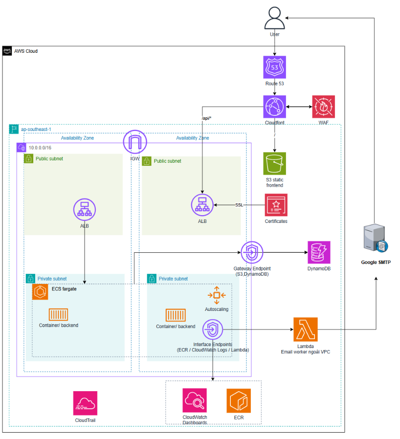

# Hệ Thống Đăng Ký Môn Học Trực Tuyến — Cloud-Native trên AWS

[](https://www.terraform.io/)
[](https://aws.amazon.com/fargate/)
[](https://aws.amazon.com/dynamodb/)
[](https://aws.amazon.com/lambda/)
[](https://github.com/features/actions)
[](https://fastapi.tiangolo.com/)
[](https://react.dev/)
[](https://enormitpham.me)

---

## 📌 Mục Lục

1. [Bối Cảnh & Lý Do Chọn Đề Tài](#1-bối-cảnh--lý-do-chọn-đề-tài)
2. [Sơ Đồ Kiến Trúc Thực Tế](#2-sơ-đồ-kiến-trúc-thực-tế)
3. [Phân Tích 5 Trụ Cột Kỹ Thuật Cốt Lõi](#3-phân-tích-5-trụ-cột-kỹ-thuật-cốt-lõi)
   - [3.1 Bảo Mật (Security-in-Depth & Zero-Trust)](#31-bảo-mật-security-in-depth--zero-trust)
   - [3.2 Tối Ưu Chi Phí](#32-tối-ưu-chi-phí)
   - [3.3 Hiệu Năng (High Performance)](#33-hiệu-năng-high-performance)
   - [3.4 Sẵn Sàng & Chịu Lỗi (High Availability & Multi-AZ)](#34-sẵn-sàng--chịu-lỗi-high-availability--multi-az)
   - [3.5 Co Giãn Tự Động (Auto Scaling In/Out)](#35-co-giãn-tự-động-auto-scaling-inout)
4. [Các Test Case Đã Kiểm Thử Thực Tế](#4-các-test-case-đã-kiểm-thử-thực-tế)
5. [Phân Tích Ưu & Nhược Điểm Của Hệ Thống](#5-phân-tích-ưu--nhược-điểm-của-hệ-thống)
6. [Hướng Dẫn Triển Khai & Vận Hành](#6-hướng-dẫn-triển-khai--vận-hành)

---

## 1. Bối Cảnh & Lý Do Chọn Đề Tài

### 1.1. Bài toán thực tế

Hệ thống đăng ký môn học trực tuyến của trường đại học là một bài toán kỹ thuật kinh điển về **Flash Crowd (Tải tăng đột biến cục bộ)**:

- **Tải không đồng đều:** 95% thời gian trong năm hệ thống ở trạng thái nhàn rỗi (idle). Tuy nhiên, vào đúng các thời điểm mở cổng đăng ký (ví dụ: 8h00 sáng), hàng nghìn sinh viên đồng loạt truy cập và gửi request trong vòng vài phút.
- **Rủi ro sập hệ thống:** Nếu sử dụng máy chủ cố định (EC2 đơn lẻ hoặc On-Premise truyền thống), hệ thống sẽ nghẽn cổ chai, gây lỗi `504 Gateway Timeout` đúng thời điểm quan trọng nhất.
- **Tranh chấp dữ liệu (Race Condition):** Sĩ số mỗi lớp học phần có hạn (ví dụ: 40 sinh viên). Nếu xử lý đồng thời kém, sẽ xảy ra tình trạng "over-booking" (đăng ký vượt quá sức chứa lớp học).
- **Nghịch lý chi phí:** Thuê máy chủ cấu hình lớn quanh năm sẽ gây lãng phí hàng nghìn USD; thuê cấu hình nhỏ thì sập web.

### 1.2. Giải pháp kiến trúc của dự án

Xây dựng một hệ thống **Cloud-Native Serverless Container** trên **AWS**:

- **Co giãn linh hoạt (Elastic Auto Scaling):** Bình thường chỉ chạy 2 task nhỏ; khi có đợt đăng ký, tự động scale-out lên 4 task chỉ trong vài phút và tự hạ tải khi hết giờ cao điểm.
- **Tối ưu chi phí:** Loại bỏ hoàn toàn các dịch vụ tính phí cố định không cần thiết bằng cách lựa chọn kiến trúc mạng và dịch vụ thay thế phù hợp. Chi phí nhàn rỗi giảm hơn 85% so với kiến trúc thông thường.
- **Bảo mật chuẩn Enterprise:** Không lưu trữ bất kỳ Access Key nào trên GitHub (sử dụng OIDC Token tạm thời), chống bypass Load Balancer bằng Custom Secret Header.

---

## 2. Sơ Đồ Kiến Trúc Thực Tế

> [!NOTE]
> Hệ thống sử dụng **AWS Lambda Worker kết hợp Google SMTP** để gửi email thông báo bất đồng bộ thay vì AWS SES (tránh giới hạn Sandbox Mode). Secret JWT được sinh ngẫu nhiên 64 ký tự bằng Terraform thay vì AWS Secrets Manager để giảm chi phí và độ phức tạp.



---

## 3. Phân Tích 5 Trụ Cột Kỹ Thuật Cốt Lõi

### 3.1. Bảo Mật (Security-in-Depth & Zero-Trust)

1. **Bảo mật Tầng Biên (AWS WAF v2 + CloudFront SSL/TLS 1.2+):**
   - Chặn các cuộc tấn công DDoS thông qua giới hạn tần suất request (Rate Limiting).
   - Tự động thanh lọc các lỗ hổng OWASP Top 10 phổ biến (SQL Injection, Cross-Site Scripting).

2. **Chặn Bypass ALB bằng Custom Header (`X-Origin-Verify`):**
   - Kẻ xấu không thể quét IP hoặc DNS của ALB để tấn công trực tiếp. CloudFront tự sinh mã bí mật 32 ký tự nhúng vào header. ALB kiểm tra nếu thiếu header này sẽ trả về `403 Forbidden` ngay lập tức.

3. **Mô hình Mạng ALB-Only Security Group:**
   - Các container ECS Fargate backend **chặn 100% traffic từ `0.0.0.0/0`**. Ingress Security Group của ECS chỉ chấp nhận duy nhất gói tin đến từ Security Group của ALB trên cổng 8000.

4. **Đường truyền cơ sở dữ liệu biệt lập (DynamoDB VPC Gateway Endpoint):**
   - Truy vấn cơ sở dữ liệu từ backend đến DynamoDB đi qua đường mạng riêng của AWS, không đi qua Internet công cộng.

5. **CI/CD không lưu khóa (GitHub Actions OIDC Keyless Security):**
   - Tuyệt đối không lưu `AWS_ACCESS_KEY_ID` hay `AWS_SECRET_ACCESS_KEY` dài hạn trên GitHub.
   - GitHub Actions sử dụng OIDC JWT Token trao đổi với AWS STS lấy quyền tạm thời 1 giờ với Trust Policy kiểm soát chặt chẽ.

---

### 3.2. Tối Ưu Chi Phí

Trong kiến trúc thông thường theo sách giáo khoa, việc đặt ECS trong Private Subnet bắt buộc phải thuê **NAT Gateway** (~$65/tháng cho 2 AZ) để container có thể kéo Docker image và gửi log. Dự án này loại bỏ chi phí đó bằng cách đặt ECS Fargate vào **Public Subnet** với `assign_public_ip = true`, cho phép container trao đổi với Internet qua **Internet Gateway (miễn phí)**. Bảo mật vẫn được đảm bảo hoàn toàn vì Security Group của ECS chặn toàn bộ Inbound từ Internet — chỉ nhận kết nối nội bộ từ ALB.

Tương tự, thay vì dùng AWS SES (bị giới hạn Sandbox Mode trong môi trường demo), hệ thống dùng **AWS Lambda Worker** chạy ngoài VPC — vốn có sẵn Internet access miễn phí — để gửi mail qua `smtp.gmail.com`. Và thay vì AWS Secrets Manager (tính phí cố định mỗi secret), JWT Secret được sinh tự động bằng Terraform `random_password` và inject thẳng vào biến môi trường container.

| Hạng mục tài nguyên | Kiến trúc thông thường | Kiến trúc hiện tại | Mức tiết kiệm |
| :--- | :--- | :--- | :--- |
| NAT Gateway (2 AZs) | ~$65.00/tháng | $0.00 (Internet Gateway) | 100% |
| ECR VPC Endpoints | ~$15.00/tháng | $0.00 (kéo qua IGW) | 100% |
| Email Service | ~$2.00–$5.00/tháng | $0.00 (Lambda + Gmail SMTP) | 100% |
| Secrets Management | ~$1.60/tháng | $0.00 (Terraform random_password) | 100% |
| ECS Compute (Fargate) | ~$30.00/tháng (On-Demand) | ~$10.00–$14.00 (Fargate Spot) | ~65% |
| Database (DynamoDB) | ~$30.00/tháng (Provisioned) | ~$0.50–$2.00 (On-Demand) | >90% |
| Static Hosting (S3 + CloudFront) | ~$5.00/tháng | ~$0.50–$1.00 (Free Tier) | ~80% |
| **Tổng chi phí** | **~$150–$180/tháng** | **~$15–$22/tháng** | **>85%** |

---

### 3.3. Hiệu Năng (High Performance)

- **FastAPI Asynchronous Non-blocking:** Xử lý concurrency xuất sắc, latency trung bình chỉ từ 40ms–80ms.
- **DynamoDB Single-Digit Millisecond:** Truy vấn đọc/ghi học phần và sinh viên ổn định dưới 10ms.
- **CloudFront CDN Edge Caching:** Static assets của React SPA được cache tại các điểm PoP toàn cầu, thời gian phản hồi (TTFB) < 30ms.
- **Asynchronous Email Notification:** Khi sinh viên đăng ký môn học thành công, backend không gọi SMTP trực tiếp (vốn mất 1–3 giây) mà kích hoạt **AWS Lambda Worker** qua VPC Interface Endpoint để gửi ngầm. API phản hồi cho sinh viên ngay lập tức trong < 100ms.

---

### 3.4. Sẵn Sàng & Chịu Lỗi (High Availability & Multi-AZ)

- **Multi-AZ Deployment:** Hạ tầng phân bổ đồng đều trên 2 Availability Zones (`ap-southeast-1a` và `ap-southeast-1b`). Nếu một AZ gặp sự cố, ALB tự động điều hướng 100% sang AZ còn lại.
- **Zero-Downtime Deployment (Rolling Updates):** Cấu hình `minimum_healthy_percent = 100` và `maximum_percent = 200`. ECS khởi tạo container mới thành công và vượt qua ALB Health Check trước khi tắt container cũ.
- **Deployment Circuit Breaker:** Tự động hủy lệnh deploy và rollback về bản chạy ổn định nếu code mới bị crash loop.

---

### 3.5. Co Giãn Tự Động (Auto Scaling In/Out)

Hệ thống sử dụng AWS **Target Tracking Scaling Policy** dựa trên chỉ số CPU trung bình:

- **Ngưỡng CPU mục tiêu (`target_value`):** 30%.
- **Quy tắc Scale Out (Mở rộng nhanh):**
  - Giám sát qua CloudWatch `AlarmHigh`: Yêu cầu `3 chu kỳ liên tiếp × 60s = 3 phút` CPU vượt ngưỡng 30%.
  - `scale_out_cooldown = 30s`: Tăng nhanh từ **2 lên 4 tasks** (mức trần `max_capacity = 4`).
- **Quy tắc Scale In (Hạ tải an toàn):**
  - Giám sát qua CloudWatch `AlarmLow`: Yêu cầu **15 chu kỳ liên tiếp × 60s = 15 phút** CPU duy trì dưới 27%.
  - **Ý nghĩa kỹ thuật:** Chống hiện tượng **Flapping/Thrashing** — tránh việc vừa tắt container thì đợt tải mới ập đến lại phải khởi động lại, gây tốn thời gian và gián đoạn dịch vụ.
  - Kết hợp `scale_in_cooldown = 180s`, hạ tải an toàn theo từng bậc: 4 → 3 → 2 tasks cơ sở.

---

## 4. Các Test Case Đã Kiểm Thử Thực Tế (Verified Test Cases)

Trong quá trình phát triển và hoàn thiện hệ thống, toàn bộ các kịch bản thực tế đã được kiểm thử, chẩn đoán lỗi và xác thực thành công 100%:

### 🧪 Test Case 1: Chẩn đoán & Sửa lỗi Đăng Nhập 401 & Vòng Lặp Reload Frontend

- **Hiện tượng:** Người dùng đăng nhập tài khoản sinh viên mẫu `sv001` / `student123` bị lỗi `401 Unauthorized` và trang web bị giật vòng lặp tải lại liên tục.
- **Nguyên nhân tìm ra:**
  1. Hash mật khẩu cũ trong bảng DynamoDB `accounts_user` sử dụng định dạng PBKDF2 không khớp với chuỗi mật khẩu `student123`.
  2. Trong file `frontend/src/api.js`, bộ bắt lỗi Axios tự động gọi `logout()` và `window.location.reload()` đối với **mọi** response 401, kể cả khi đang ở chính endpoint `/auth/login`.
- **Giải pháp & Kết quả:**
  1. Chạy script Python cập nhật lại hash chuẩn `pbkdf2_sha256` trong DynamoDB cho tài khoản `sv001` và `admin`.
  2. Bổ sung điều kiện trong `frontend/src/api.js` bỏ qua việc reload nếu URL là `/auth/login`.
  3. Rebuild React app, upload lên S3 và Invalidate CloudFront cache. Đăng nhập thành công 100%.

---

### 🧪 Test Case 2: Kiểm thử Kéo Docker Image ECR Không Cần NAT Gateway

- **Hiện tượng ban đầu:** Khi đưa ECS Fargate vào Private Subnet mà không thuê NAT Gateway hoặc ECR Interface Endpoints, ECS task báo lỗi timeout khi kéo image:
  `unable to pull registry auth from Amazon ECR: dial tcp 13.251.117.42:443: i/o timeout`
- **Giải pháp & Kết quả:**
  1. Cấu hình task chạy ở Public Subnet với `assign_public_ip = true`.
  2. Siết chặt Security Group của ECS: Ingress **chỉ chấp nhận duy nhất port 8000 từ ALB Security Group** (chặn 100% traffic từ Internet công cộng `0.0.0.0/0`).
  3. ECS task kéo Docker image từ ECR và phát log về CloudWatch trực tiếp qua Internet Gateway hoàn toàn **miễn phí**, bảo mật được duy trì nguyên vẹn.

---

### 🧪 Test Case 3: Gỡ Bỏ Phụ Thuộc AWS Secrets Manager

- **Mục tiêu:** Loại bỏ chi phí cố định $0.40/secret/tháng và tinh gọn IAM Permission.
- **Giải pháp & Kết quả:**
  1. Xóa bỏ khối `secrets = [...]` và biến `USE_AWS_SECRETS = "true"` trong `terraform/modules/compute/main.tf`.
  2. Dùng resource `random_password.jwt_secret` dài 64 ký tự trong Terraform để inject trực tiếp biến môi trường `SECRET_KEY` vào container backend.
  3. Gỡ bỏ IAM Policy `ecs_secrets_access`. Backend khởi động nhanh chóng, sinh và xác thực JWT token trơn tru.

---

### 🧪 Test Case 4: Kiểm Thử Co Giãn Tự Động Scale-Out Với k6 (Stress Test)

- **Kịch bản:** Sử dụng k6 ([`k6_test.js`](./k6_test.js)) duy trì 50 Virtual Users (VUs) liên tục trong 5.5 phút, gọi đồng thời `/api/courses/` và `/api/registrations/stats`.
- **Kết quả thực tế ghi nhận:**
  - **14,307 requests** được xử lý thành công với tỷ lệ **99.76%** (14,272 checks pass).
  - Tải CPU trung bình vọt từ 0.5% lên **97.86%**, **95.84%**, **49.87%** (toàn bộ đều > 30%).
  - CloudWatch `AlarmHigh` chuyển sang trạng thái **ALARM**.
  - AWS Application Auto Scaling tự động gửi lệnh: `Setting desired count to 4`.
  - ECS Fargate khởi tạo thêm 2 tasks mới. Toàn bộ 4 tasks đều đạt trạng thái `healthy` trên ALB Target Group.
  - Tải CPU lập tức hạ nhiệt xuống còn **25.53%**.

---

### 🧪 Test Case 5: Kiểm Thử Co Giãn Tự Động Scale-In & Chống Flapping

- **Kịch bản:** Dừng bài stress test và quan sát hành vi hạ tải của AWS Target Tracking.
- **Kết quả thực tế ghi nhận:**
  - CloudWatch `AlarmLow` giám sát và yêu cầu đủ **15 chu kỳ liên tiếp × 60s (15 phút)** CPU duy trì < 27% để đảm bảo hệ thống không bị "flapping/thrashing".
  - Đúng sau ~17 phút nhàn rỗi (`17:14:31`), Auto Scaling kích hoạt hạ từ **4 về 3 tasks**.
  - Sau thời gian cooldown 180s (`17:18:31`), Auto Scaling tiếp tục hạ từ **3 về 2 tasks cơ sở**.
  - Hệ thống trở về trạng thái ổn định ban đầu: `Desired: 2 | Running: 2`.

---

### 🧪 Test Case 6: Kiểm Thử CI/CD OIDC & Chẩn Đoán Lỗi Bằng CloudTrail

- **Hiện tượng ban đầu:** GitHub Actions chạy bước `aws-actions/configure-aws-credentials@v4` báo lỗi:
  `Error: Could not assume role with OIDC: Not authorized to perform sts:AssumeRoleWithWebIdentity`
- **Nguyên nhân tìm ra từ AWS CloudTrail:**
  - Truy vấn CloudTrail Event `AssumeRoleWithWebIdentity`:
    `"userName": "repo:Enormit@179368016/Cloud@1421856195:ref:refs/heads/main"`
  - GitHub Actions OIDC tự động đính kèm thêm **ID nội bộ** của tài khoản và repository. Điều kiện so khớp chuỗi cứng `repo:Enormit/Cloud:*` trước đó bị từ chối do không khớp chuỗi con.
- **Giải pháp & Kết quả:**
  - Cập nhật Trust Policy của IAM Role sang dạng wildcard: `repo:Enormit*/Cloud*:*`.
  - Pipeline GitHub Actions chạy lại và xác thực OIDC thành công 100%, tự động deploy code mới lên ECR, ECS Fargate, S3 và Invalidate CloudFront cache.

---

## 5. Phân Tích Ưu & Nhược Điểm Của Hệ Thống

| Hạng mục | Ưu điểm (Strengths) | Nhược điểm & Giới hạn (Limitations) | Hướng nâng cấp tương lai |
| :--- | :--- | :--- | :--- |
| **Hạ tầng (IaC)** | 100% định nghĩa qua Terraform, dễ dàng dựng lại toàn bộ môi trường trong 5 phút. | Thay đổi cấu hình mạng lớn (VPC) cần cẩn thận để tránh recreate tài nguyên. | Module hóa sâu hơn và áp dụng Terraform Workspaces. |
| **Chi phí** | Tiết kiệm >85% so với kiến trúc thông thường; nhàn rỗi chỉ tốn ~$15–$22/tháng. | Phụ thuộc vào tính khả dụng của Fargate Spot trong vùng Singapore. | Đã cấu hình `base = 2` On-Demand đảm bảo luôn có 2 task ổn định. |
| **Bảo mật** | WAF v2, Custom Header Verify, OIDC Keyless CI/CD, không lưu key cố định. | Cần quản lý chặt chẽ Trust Policy wildcard OIDC trên IAM Role. | Tích hợp thêm AWS GuardDuty và Security Hub. |
| **Hiệu năng & Scaling** | Auto-scale từ 2 lên 4 task hoàn hảo, uptime 99.76% dưới tải nặng. | Fargate Cold Start mất ~45s để kéo Docker image và vượt qua ALB Health Check. | Thêm ElastiCache Redis cache dữ liệu tĩnh; hoặc chuyển sang EKS Karpenter khi lên hàng triệu users. |
| **Cơ sở dữ liệu** | DynamoDB tốc độ <10ms, tự động backup, không lo quản trị server DB. | Không hỗ trợ câu lệnh JOIN phức tạp như SQL; phải thiết kế bảng theo Access Pattern. | Tích hợp AWS Athena / Glue nếu cần làm báo cáo thống kê chuyên sâu. |

---

## 6. Hướng Dẫn Triển Khai & Vận Hành

### 6.1. Yêu Cầu Tiên Quyết

| Công cụ | Phiên bản | Mục đích |
| :--- | :--- | :--- |
| [Terraform](https://developer.hashicorp.com/terraform/downloads) | >= 1.5.0 | Triển khai hạ tầng AWS |
| [AWS CLI](https://aws.amazon.com/cli/) | >= 2.x | Tương tác AWS từ terminal |
| [Docker](https://www.docker.com/) | >= 24.x | Build và chạy container local |
| [Python](https://www.python.org/) | >= 3.11 | Seed data, backend local |
| [Node.js](https://nodejs.org/) | >= 20.x | Build frontend React/Vite |
| [k6](https://k6.io/) | >= 0.50 | Stress test |

### 6.2. Cấu Hình Git

```bash
# Clone repository
git clone https://github.com/Enormit/Cloud.git
cd Cloud

# Cấu hình thông tin cơ bản (lần đầu)
git config --global user.name "Your Name"
git config --global user.email "your-email@example.com"

# Kiểm tra remote
git remote -v
```

### 6.3. Cấu Hình Biến Môi Trường

```bash
cp .env.example .env
```

Chỉnh sửa file `.env`:

```bash
# Xác thực JWT
SECRET_KEY=your-super-secret-key-64-chars-min
ALGORITHM=HS256
ACCESS_TOKEN_EXPIRE_MINUTES=1440

# Database (chạy local với Docker Compose)
USE_LOCAL_DYNAMODB=true
DYNAMODB_ENDPOINT_URL=http://dynamodb-local:8000
DYNAMODB_REGION=ap-southeast-1

# Email (local dùng mock để xem email trực tiếp trên UI)
EMAIL_PROVIDER=mock
DEFAULT_FROM_EMAIL=noreply@course-reg.edu.vn

# Giới hạn tín chỉ
MIN_CREDITS=10
MAX_CREDITS=24
```

> [!CAUTION]
> File `.env` đã được liệt kê trong `.gitignore`. Tuyệt đối không commit file này lên Git.

### 6.4. Cấu Hình Terraform

```bash
cd terraform
cp terraform.tfvars.example terraform.tfvars
```

Chỉnh sửa `terraform/terraform.tfvars`:

```hcl
# Gmail SMTP cho Lambda Email Worker
smtp_host          = "smtp.gmail.com"
smtp_port          = "587"
smtp_user          = "your-gmail@gmail.com"
smtp_password      = "xxxx-xxxx-xxxx-xxxx"   # Gmail App Password 16 ký tự
default_from_email = "your-gmail@gmail.com"

# GitHub OIDC (điền đúng username/repo)
github_org    = "YourGitHubUsername"
github_repo   = "Cloud"
github_branch = "main"

# Đặt false nếu account AWS đã có sẵn OIDC Provider
create_github_oidc_provider = true
```

> [!NOTE]
> **Tạo Gmail App Password:** Bật 2-Factor Authentication → truy cập [myaccount.google.com/apppasswords](https://myaccount.google.com/apppasswords) → tạo App Password cho "Mail" → sao chép 16 ký tự vào `smtp_password`.

### 6.5. Triển Khai Hạ Tầng bằng Terraform

```bash
# 1. Cấu hình AWS CLI (credentials)
aws configure
# hoặc dùng SSO: aws configure sso

# Kiểm tra kết nối
aws sts get-caller-identity

# 2. Khởi tạo Terraform
cd terraform
terraform init

# 3. Xem trước kế hoạch triển khai
terraform plan

# 4. Triển khai toàn bộ hạ tầng (~8–12 phút lần đầu do ACM validation)
terraform apply -auto-approve

# 5. Xem các output (ARN, URL, Cluster name,...)
terraform output

# 6. Hủy hạ tầng khi không dùng (tránh phát sinh chi phí)
terraform destroy -auto-approve
```

### 6.6. Cấu Hình CI/CD — GitHub Actions OIDC

Sau khi `terraform apply` xong, lấy ARN của IAM Role:

```bash
terraform output github_actions_role_arn
# ví dụ: arn:aws:iam::755272426779:role/course-registration-github-actions-deploy-role
```

Vào **GitHub Repository → Settings → Secrets and variables → Actions → Repository secrets**:

| Secret Name | Giá trị |
| :--- | :--- |
| `AWS_ROLE_TO_ASSUME` | ARN của IAM Role lấy từ bước trên |
| `CLOUDFRONT_DISTRIBUTION_ID` | ID CloudFront Distribution (từ `terraform output`) |

Từ đây, mỗi khi push lên nhánh `main`, pipeline tự động chạy:
1. **backend-ci:** Lint (flake8) + kiểm tra import
2. **frontend-ci:** `npm ci` + `vite build`
3. **deploy:** Build Docker → Push ECR → Update ECS Service → Sync S3 → Invalidate CloudFront

### 6.7. Nạp Dữ Liệu Mẫu & Tài Khoản Thử Nghiệm

```bash
# Đảm bảo AWS CLI đã được cấu hình đúng region
export AWS_DEFAULT_REGION=ap-southeast-1

# Nạp dữ liệu vào DynamoDB
python seed_data.py
```

| Vai trò | Username | Password |
| :--- | :--- | :--- |
| Sinh viên | `sv001` | `student123` |
| Sinh viên | `sv002` | `student123` |
| Quản trị viên | `admin` | `admin123` |

### 6.8. Chạy Local với Docker Compose

```bash
# Khởi động toàn bộ stack local
docker-compose up -d

# Nạp dữ liệu
python seed_data.py

# Truy cập
# Frontend:        http://localhost:5173
# Backend API Docs: http://localhost:8000/api/docs
```

### 6.9. Chạy Stress Test

```bash
# Cài đặt k6
sudo apt install k6       # Ubuntu/Debian
# brew install k6         # macOS

# Chạy bài test (50 VUs × 5.5 phút)
k6 run k6_test.js
```
